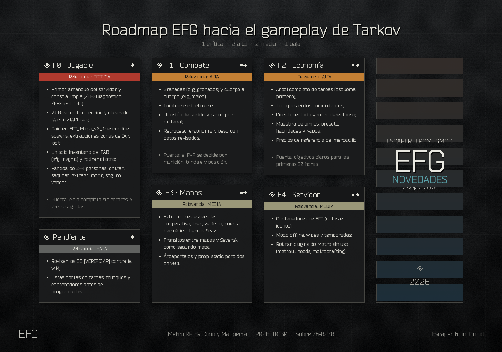

# EFG: Escape from Gmod

**EFG** es un modo de extracción al estilo *Escape from Tarkov* para Garry's Mod, construido como schema de **[Helix](https://github.com/nebulouscloud/helix)**. Se ha construido entero alrededor del ciclo de EFT: preparas a tu PMC en el escondite, entras en una raid, sobrevives, saqueas y extraes (o lo pierdes todo).

- **Lenguaje**: GLua (Lua 5.1 de Garry's Mod) sobre la API `ix.*` de Helix.
- **Idioma del juego**: español.
- **Moneda**: rublos (objeto `rublos`), más dólares y euros.
- **Bandos**: USEC y BEAR (PMC), Scav (Scav run) y Staff.
- **Estado**: casi todo lo que hay aquí está programado pero **sin probar en partida**. Los valores marcados con `[VERIFICAR]` en la configuración son aproximaciones a la wiki de EFT pendientes de revisar.

---

## Roadmap



Fases hacia el gameplay de Escape from Tarkov (sistemas y bucle de EFT con assets propios de EFG). F0 bloquea el resto: primer bucle jugable probado en partida. Datos en `docs/roadmap/json/`.

---

## Índice

1. [Instalación](#instalación)
2. [Ciclo de juego](#ciclo-de-juego)
3. [Controles](#controles)
4. [El menú TAB](#el-menú-tab)
5. [Plugins de EFG](#plugins-de-efg)
6. [Otros plugins activos](#otros-plugins-activos)
7. [Comandos](#comandos)
8. [Configuración](#configuración)
9. [Estructura del repositorio](#estructura-del-repositorio)
10. [Herramientas](#herramientas)
11. [Desarrollo](#desarrollo)

---

## Instalación

### Requisitos

- Garry's Mod (servidor dedicado o *listen server*).
- **Helix** en `garrysmod/gamemodes/helix`.
- La **colección de Workshop** del servidor: <https://steamcommunity.com/sharedfiles/filedetails/?id=3224545557>. Trae los modelos de PMC y Scav, las armas **ARC9** de EFT (base ARC9 incluida), las voces, los mapas (Customs, Factory, gm_russia...) y los SNPC de EFT.
- **VJ Base** para la IA (`efg_ai`). Todavía no está en la colección: hay que añadirlo.
- **Content_Test_Metro_P2** (<https://steamcommunity.com/sharedfiles/filedetails/?id=3744199003>): sonidos y modelos de STALKER 2 de la comida y la mochila. No está en la colección; `efg_ui` lo manda a los clientes con `resource.AddWorkshop`.

Todo se trabaja en `garrysmod/gamemodes` (Helix + este schema). En `garrysmod/addons` no va ningún paquete del modo: los addons de la colección se instalan suscribiéndose a ella en Workshop (o con `host_workshop_collection` en un servidor dedicado) y el contenido propio sale de `content/`, que GMod monta solo desde la carpeta del gamemode. En `addons` solo quedan los mapas propios que aún no están en Workshop.

### Pasos

1. Copia Helix a `garrysmod/gamemodes/helix`.
2. Copia este repositorio a `garrysmod/gamemodes/escapefromgmod`. La carpeta **tiene que llamarse `escapefromgmod`**, porque así se llama `escapefromgmod.txt`.
   - En Windows, `tools/compilar.bat` hace la copia (sin `.git`, `_retirados`, `tools`...) y además empaqueta `content/` en un `.gma` con `gmad.exe`. `tools/compilar.bat copiar` solo copia.
3. Arranca el servidor con el gamemode y la colección:

   ```
   srcds.exe -game garrysmod +gamemode escapefromgmod +map <mapa> +host_workshop_collection 3224545557
   ```

4. El contenido propio (`content/`: texturas, sonidos, modelos y la fuente Bender) se manda a los clientes con `resource.AddFile` (`efg_ui`, `efg_server`). Con `efgAutoWorkshop` activo, el servidor manda también los addons de la colección a cada jugador al entrar.
5. Ya en el servidor, como admin:
   - `/EFGDiagnostico` comprueba que están ARC9, VJ Base, el mapa, la munición, las llaves, los estimulantes y las clases de NPC.
   - `/RaidSetEscondite` en el punto del escondite, `/RaidAddSpawn` en los puntos de aparición y `/RaidAddExtract` en cada extracción.
   - `/IAZonaAdd` para las zonas de IA, `/LootAreaCreate` y `/LootAddPoint` para el botín y `/TraderSpawn` para los comerciantes.

---

## Ciclo de juego

1. **Creación del PMC** (`efg_pmc`): bando (USEC o BEAR), apariencia y accesorios, 10 puntos de atributos, rol con equipo inicial (Asaltante, Tirador o Médico) e identidad. Un PMC por cuenta y nombre único.
2. **Escondite**: zona segura con radio configurable. Desde el TAB compras a los comerciantes, mejoras módulos, fabricas, vendes en el mercadillo y aseguras el equipo.
3. **Raid** (`/Raid` o pestaña MAPA): cuenta atrás de despliegue, apareces en un punto del mapa con el reloj de la raid corriendo. Hay grupos de hasta 5 jugadores; el líder despliega a todos.
4. **Supervivencia**: salud por partes, sangrados, fracturas, sangre, tensión, SpO2, hidratación, energía y efectos de estado. IA de Scavs, francotiradores, PMC y jefes.
5. **Extracción**: cada raid abre extracciones fijas, aleatorias, de pago, sin mochila y de interruptor. Con la tecla **O** ves el tiempo y tus salidas.
6. **Resultado**: si extraes, conservas lo que llevas y ganas XP; si mueres o se acaba el tiempo (MIA), pierdes el equipo salvo el contenedor seguro y lo asegurado que nadie recoja.
7. **Scav run** (`/RaidScav`): entras como Scav con equipo aleatorio sin arriesgar al PMC. Tiene espera entre partidas y depende del karma con Fence.

---

## Controles

| Tecla | Qué hace |
|---|---|
| **TAB** | Abre el menú único con todas las pantallas del jugador |
| **Z** (mantener) | Menú radial: cargador, modo de disparo, extracciones, salud, medicinas, inventario y atuendo |
| **O** | Una pulsación: tiempo de raid. Dos: lista de extracciones |
| **ALT + T** | Comprobar el cargador |
| **ALT + B** | Comprobar el modo de disparo |
| **1-5** | Acceso rápido (se asigna desde el TAB) |
| **N** | Visión nocturna (con el objeto `nvg`) |
| **Bloq Mayús** | Tercera persona |
| **Recargar** con el arma averiada | Arregla el fallo (encasquillamiento, alimentación...) |

En el inventario:

- **R** gira el objeto, también mientras lo arrastras.
- **Ctrl + clic** lo mueve al otro inventario abierto.
- **Alt + clic** lo equipa o lo quita.
- **Doble clic** abre contenedores, usa o examina.
- **Clic derecho**: menú contextual con Inspeccionar, Asegurar (Prapor o Therapist), Reparar en comerciante (Prapor o Mechanic), Reparar con kit, Cambiar munición, Descargar y la pantalla de modding del arma.
- Lo encontrado en raid aparece como **?** hasta que lo **examinas**.

---

## El menú TAB

`ix_invkey` sustituye el menú de Helix por un único TAB (`ixEFGInventory`) con una barra de secciones al estilo de la pantalla de personaje de EFT:

| Pestaña | Contenido | Plugin |
|---|---|---|
| GENERAL | Estadísticas del PMC, modelo, ropa | `efg_profile` |
| EQUIPO | Inventario: equipo, táctico, alijo y acceso rápido | `efg_invgrid` (VGUI) o `efg_invhtml` (DHTML) |
| SALUD | Silueta por partes, monitor de constantes con ECG, medicinas | `efg_health`, `efg_physio` |
| HABILIDADES | Habilidades del PMC y su progreso | `habilidades`, `efg_profile` |
| MAPA | Selección de localización y despliegue | `efg_menus`, `efg_raids` |
| TAREAS | Tareas de cada comerciante con objetivos y recompensas | `efg_tasks`, `missions`, `efg_quests` |
| LOGROS | Logros del PMC | `efg_profile` |
| COMERCIANTES | Pantalla de comerciante de EFT (diálogo, compra y venta) | `traders` |
| ESCONDITE | Módulos y fabricación | `efg_hideout`, `efg_hideout_extra`, `efg_production` |
| MERCADILLO | Mercado entre jugadores | `efg_flea` |
| AJUSTES | Opciones del jugador | `ix_invkey` |

Para abrir una pestaña desde otro plugin: `ix.gui.invKeyStartTab = "<id>"` y crear el TAB (ids: `char`, `inv`, `health`, `skills`, `raid`, `tasks`, `achievements`, `traders`, `hideout`, `flea`, `settings`). El menú base de Helix sigue disponible para admins con `/OpenHelixMenu`.

---

## Plugins de EFG

### Raid y mapas

| Plugin | Qué hace |
|---|---|
| `efg_raids` | Ciclo de raid: despliegue desde el escondite, temporizador, extracciones (siempre, aleatoria, de pago, sin mochila, interruptor), MIA, Run Through, XP y nivel del PMC, grupos y Scav run (`sv_scav.lua`). Interfaz de extracciones de la tecla O en `cl_extracts.lua`. |
| `efg_maps` | Datos de las 10 localizaciones de EFT (Aduanas, Fábrica, Bosque, Costa, Intercambiador, Reserva, Faro, Calles de Tarkov, Zona cero, Laboratorio): duración, jefes y jugadores. Reloj de raid acelerado con día y noche, clima, llaves de EFT y puertas cerradas con llave. |
| `efg_ai` | Zonas de IA (VJ Base) que generan oleadas mientras hay jugadores cerca: Scavs, francotiradores, PMC, Raiders, Rogues, cultistas y jefes (Reshala, Killa, Tagilla, Shturman, Glukhar, Kaban, Kollontay, Zryachiy, Goons, Partisan...). |
| `efg_karma` | Karma Scav (reputación con Fence): baja al matar Scavs siendo Scav, sube al extraer y cambia la espera y la hostilidad de la IA. |
| `efg_menus` | Pantallas de flujo: menú de entrada, selección de raid, despliegue con controles e inspección de objetos. |
| `efg_server` | Wipe, modo PvE/PvP, cola para buscar grupo, anticheat de velocidad y de distancia de saqueo, descarga del contenido y de la colección, y autodiagnóstico. |
| `efg_guard` | Anticheat de red: limita los mensajes por jugador y expulsa a quien abusa. |

### Salud y estado

| Plugin | Qué hace |
|---|---|
| `efg_health` | Salud por partes como EFT (cabeza 35, tórax 85, estómago 70, brazos 60, piernas 65: 440 en total), sangrados leves y graves, fracturas, dolor, extremidades destruidas y daño repartido. Botiquines, vendas, torniquetes, férulas, cirugía y estimulantes (`items/efgmed`) con animación en primera persona (SWEP `efg_med`). Protección de chalecos y cascos en `ScalePlayerDamage`. Pestaña SALUD con silueta, arrastre de medicinas a cada parte y movimiento con inercia (`cl_movement.lua`). |
| `efg_physio` | Fisiología al estilo KAT encima de `efg_health`: 6 L de sangre y tensión, shock hipovolémico II-IV, SpO2, neumotórax abierto y a tensión, vía aérea, inconsciencia (ragdoll de Helix), parada cardiaca con RCP, daño cerebral por hipoxia y grupos sanguíneos (transfusión incompatible = reacción hemolítica). Material de soporte vital (`items/efgphysio`) usable en uno mismo o en un compañero. Los brazos dañados alargan el uso de objetos y las recargas. |
| `efg_status` | Hidratación y energía de EFT (sustituye a `needs`), deshidratación, agotamiento, conmoción, temblores, visión túnel y fractura de pierna. |
| `efg_effects` | Efectos temporales: estimulantes, herida fresca, fatiga, intoxicación, radiación y alcohol. |
| `anims_meds` | Comidas y bebidas de la colección como objetos de Helix con sonido, animación y efectos. |

### Armas y combate

| Plugin | Qué hace |
|---|---|
| `efg_arc9` | Registra como objeto de Helix cada arma ARC9 de EFT instalada (`arc9_eft_*`, `arc9_wtt_*`) con tamaño, peso, categoría y precio. |
| `efg_ballistics` | Munición de EFT por calibre como objetos apilables (`ammo_<calibre>_<bala>`), elección de munición por arma, fórmula de penetración y desgaste de blindaje de EFT, cascos con zonas y rebotes. |
| `efg_mags` | Cargadores como objetos: se llenan bala a bala y la recarga cambia el cargador entero. |
| `efg_mods` | Accesorios de arma como objetos que se instalan en las ranuras y cambian ergonomía, retroceso y peso. |
| `efg_weapons` | Desgaste por disparo, sobrecalentamiento, fallos y encasquillamientos, reparación con kit y efecto de los brazos heridos al disparar. |
| `efg_inspect` | Ventana de inspección en DHTML y **pantalla de modding de ARC9 al estilo EFT**: árbol de ranuras, piezas compatibles y estadísticas en vivo. |
| `arc9_support` | Soporte de accesorios y armas de ARC9 en el inventario de Helix. |
| `wepraised` | Armas siempre levantadas. |

### Equipo e inventario

| Plugin | Qué hace |
|---|---|
| `ix_invkey` | El TAB: ranuras de casco, chaleco, mochila y contenedor seguro (inventario de equipo 16x8, `ix.GetEquipSlotKind`), ranuras de arma (principal, funda, vaina), bolsillos y todas las pestañas. |
| `efg_invgrid` | Pestaña EQUIPO en VGUI (`efgxInventoryEFT`): rejillas con encaje, giro con R al arrastrar, alijo con scroll, acceso rápido y menú contextual. Se activa con `efgInvEFT`. |
| `efg_invhtml` | Pestaña de inventario en DHTML (`efgxInventoryPage`) con CSS Grid y arrastre propio. Se activa con `efgInvHTML`. |
| `efg_invrules` | Rotación de objetos, qué cabe en cada contenedor, objetos encontrados en raid (FIR), examinar y tiempo de búsqueda de contenedores y cuerpos. |
| `efg_gear` | Chalecos y cascos por clase, placas, mochilas, contenedores seguros, auriculares, gafas, cubrecaras, brazaletes y chalecos tácticos con rejilla. `libs/sh_armor.lua` define `ix.efg.armor.Setup`. |
| `efg_outfits` | PMC modulares (cabeza, chaqueta y pantalón con `/Atuendo`), modelo de Scav y equipo visible sobre el jugador y los cadáveres. |
| `efg_icons` | Iconos 2D de inventario (`ITEM.iconMaterial`) con vuelta al modelo 3D, y rareza de los objetos. |
| `efg_eftdata` | Base de datos de objetos de EFT sacada de la wiki (nombre, tipo, peso, tamaño, estadísticas) con sus iconos en `materials/eftwiki/icons`. |
| `efg_quickbar` | Barra de acceso rápido 1-5 con las texturas del selector de Tarkov. |
| `efg_radial` | Menú radial con Z. |
| `efg_insurance` | Seguro: lo asegurado que nadie se lleva vuelve al alijo tras un tiempo. |
| `strongbox` | Alijo personal (10x30, crece con el módulo Alijo). `/Alijo` lo abre. |
| `mochilas` | Bases de mochilas (las nuevas van en `plugins/mochilas/items/mochilas/`). |
| `weight` | Peso de los objetos. |
| `loot_on_death` | Todo cae al cadáver salvo lo marcado con `ITEM.noLoot`. |
| `loot` | Botín por zonas, presets de props y niveles (sistema antiguo, congelado: lo sustituye `efg_loot`). |
| `efg_loot` | Núcleo del loot de EFT: tablas de datos por contenedor y cadáver (`sh_loot_tables.lua`: categorías, tablas de Scav, PMC y contenedores del mundo, tipos de contenedor), ponderación inversa al precio (`ix.efg.loot.WeightByPrice`), sorteo `ix.efg.loot.Roll` y 35 objetos de botín (valor, inteligencia, electrónica, trueque, médicos y carteras con rublos). Contenedores del mundo (`efg_loot_container`) con contenido nuevo en cada raid, cadáver de jugador con ranuras (equipo y bolsillos, con la chapa dentro) y log en `data/efg/loot/raid_<fecha>.txt`. Hasta que llegue `efg_loot_ui`, las secciones se abren una detrás de otra en la ventana de almacenamiento. |
| `efg_loot_ai` | Loot de la IA: equipo y botín por contenedor al aparecer (Scav con objeto raro posible, PMC con equipo según su nivel hasta +10 sobre el jugador y ponderación por precio), cadáver de VJ con equipo, bolsillos, cuerpo 4x4, chaleco y mochila; los PMC de IA saquean contenedores y cuerpos, mejoran su equipo y extraen con el botín (`data/efg/loot/pmc_extract_<fecha>.txt`). |
| `efg_loot_ui` | Ventana de saqueo de EFT: TU EQUIPO a la izquierda y el cuerpo o contenedor a la derecha con tres diseños (`BuildLootLayout`: Dead Scav, réplica de PMC con ranuras, contenedor puro). Cada sección se busca aparte con siluetas que aparecen una a una; lo desconocido sale como "Objeto desconocido" hasta examinarlo con la rueda. Config `efgLootWindow`. |

### PMC, progresión y perfil

| Plugin | Qué hace |
|---|---|
| `efg_pmc` | Creador de PMC en 5 pasos (`efgPMCCreator`), accesorios estéticos con bonemerge (`cl_cosmetic.lua`), validación en el servidor (`sv_creation.lua`), voces de EFT y frases rápidas. |
| `efg_profile` | Estadísticas del PMC (raids por bando, rachas, bajas, salud, combate, botín, XP por tipo, horas) y la pestaña PERSONAJE (GENERAL, HABILIDADES, LOGROS). |
| `efg_progression` | Curva de nivel de EFT (79 niveles) y XP por examinar, saquear, curar y tiros a la cabeza. |
| `habilidades` | Habilidades (perks) que suben con el uso; sustituye a los atributos de inicio de Helix. |

### Economía y comerciantes

| Plugin | Qué hace |
|---|---|
| `traders` | Prapor, Therapist, Fence, Skier, Peacekeeper, Mechanic, Ragman y Jaeger con lealtad 1 a 4 limitada por nivel de PMC, stock físico con reposición, panel de administración y pantalla de EFT en DHTML (`efgxTrader`) con retrato o vídeo en bucle. `tradersEFTUI = false` vuelve a las ventanas antiguas. |
| `efg_economy` | Dólares y euros (cambio en Peacekeeper y Skier), reparación en Prapor y Mechanic, chapas (dogtags) y surtido de EFT. |
| `efg_flea` | Mercadillo entre jugadores desde nivel 15, con comisión, duración de ofertas y FIR obligatorio. |
| `efg_quests` | Tareas iniciales de los comerciantes basadas en las de EFT. |
| `efg_tasks` | Pestaña TAREAS como la de EFT. |
| `missions` | Motor de misiones por pasos (explorar, eliminar, buscar, entregar), editables en partida. |
| `efg_messages` | Mensajes de comerciantes (seguro, mercadillo, tareas), manual de objetos con precios y pasos que suenan según el material. |
| `intercambio` | Intercambio seguro de objetos entre jugadores. |
| `trader_logs` | Trazabilidad de lo vendido por comerciantes y detector de duplicados. |
| `money_items`, `economia_monitor` | Dinero como objeto físico y desglose de la masa monetaria. |

### Escondite

| Plugin | Qué hace |
|---|---|
| `efg_hideout` | Módulos principales: Alijo, Generador, Banco de trabajo, Estación médica, Lavabo, Unidad de nutrición, Zona de descanso y Centro de inteligencia. Se mejoran con rublos y objetos y desbloquean recetas. Sustituye a los oficios antiguos: el oficio de una receta es el módulo y `tierRequired` su nivel. |
| `efg_hideout_extra` | Resto de módulos de EFT: Seguridad, Calefacción, Iluminación, Ventilación, Recolector de agua, Filtrado de aire, Panel solar, Destilería, Granja de bitcoin, Scav Case, Galería de tiro, Biblioteca, Gimnasio, Armero de pared y Salón de la fama. Combustible del generador. |
| `efg_production` | Fabricación con tiempo: los materiales se gastan al empezar y el resultado llega al alijo. |
| `mesa_crafteo` | Mesas de fabricación del escondite colocables por admins. |

### Interfaz

| Plugin | Qué hace |
|---|---|
| `efg_ui` | Kit visual: paleta `ix.efgui.color`, utilidades (`DrawPanel`, `DrawHeader`, `DrawCell`, `StyleFrame`, `StyleButton`, `GetItemColor`), fuentes `efgui.*` en Bender, CSS común `--efg-*` para DHTML (`cl_css.lua`) y `resource.AddFile` de `content/`. |
| `efg_hud` | HUD de EFT (estado por zonas, postura, resistencia, cargador, avisos, cursor), necesidades, barra de acción y etiquetas. |
| `fix_hud_arc.lua` | Corrige `ix.util.PrecacheArc` y protege `ix.hud.DrawAll`. |

### Administración

| Plugin | Qué hace |
|---|---|
| `efg_admin` | Comandos de prueba: dinero, nivel, XP, lealtad, completar tareas y tiempo de raid. |

---

## Otros plugins activos

Plugins heredados o genéricos que siguen cargados: `adminchat`, `ambient_music`, `antibhop`, `area_visualizer`, `better_armor` (máscara de gas), `bodygroupmanager`, `cleaner`, `contextmenu` (bloquea C y Q salvo flag `z`), `disable_zoom`, `extracommands`, `flashlightitem`, `helix_menu`, `help_comandos` (`/comandos`), `hidevoicepanels`, `legs`, `menu_ui`, `needs`, `npc_custom`, `npc_obstacle_jump`, `npc_presets`, `npc_stepheight`, `observer_enhanced`, `persistent_corpses`, `puertas`, `puertas_brecheables`, `ranks`, `sh_adverts`, `simpleradio`, `spawnmenu_itemtab`, `thirdperson`, `tposefixer`, `vigilancia`, `vision_nocturna`, `vmanip_port` y `voicerevamped`.

Los plugins y facciones del schema anterior que ya no se usan están en `_retirados/` y **no se cargan** (entre otros: ANIM_INV, TABANIM, community_missions, tablon_encargos, generadores, new_wepselect, ix_cwsupport, el HUD antiguo, cartas, pasaportes, temperatura y las facciones de Metro).

---

## Comandos

Se escriben en el chat con `/`. `/comandos` los lista en partida. Hay otra copia más corta en [`COMANDOS.md`](COMANDOS.md).

### Jugador

| Comando | Qué hace |
|---|---|
| `/Lobby` | Abre el TAB en la pestaña de raid |
| `/Raid` | Despliega a tu PMC (y a tu grupo si eres el líder) |
| `/RaidScav` | Entra como Scav con equipo aleatorio |
| `/Extracciones` | Tiempo restante y extracciones (igual que la O) |
| `/Nivel` | Nivel, experiencia y estadísticas de raids |
| `/GrupoInvitar <jugador>` · `/GrupoAceptar` · `/GrupoSalir` | Grupo de raid |
| `/BuscarGrupo` | Entra o sale de la cola de búsqueda de grupo |
| `/Escondite` | Mejoras del escondite |
| `/Alijo` | Abre tu alijo |
| `/Mercadillo` | Mercadillo entre jugadores |
| `/Cambio usd\|eur <cantidad> [vender]` | Compra o vende divisas junto a Peacekeeper o Skier |
| `/Generador [repostar]` | Combustible del generador |
| `/Bitcoin [gpu\|recoger]` | Granja de bitcoin |
| `/ScavCase [2500\|15000\|95000]` | Envía al Scav Case |
| `/Mensajes` · `/Manual` | Mensajes de comerciantes y manual de objetos con precios |
| `/Atuendo` | Cabeza, chaqueta y pantalón del PMC |
| `/Voz <1-2>` · `/Frase <frase>` | Voz del PMC y frases (si, no, sigueme, espera, vamos, cubrete, listo, enemigo, ayuda, alto, despejado) |
| `/Habilidades` | Tus habilidades |
| `/Karma` | Karma Scav |
| `/Municion` | Datos de la munición del arma en mano |
| `/Hora` | Hora y clima de la raid |
| `/RCP` | Reanimación cardiopulmonar al herido que miras |
| `/GrupoSanguineo` | Tu grupo sanguíneo |
| `/estadoMision` · `/abandonarMision` | Tarea activa |
| `/Intercambiar` | Intercambio con el jugador al que miras |
| `/Gasmask` | Ponerse o quitarse la máscara de gas |
| `/r`, `/r1`, `/r2 <texto>` | Radio |
| `/voicemode` | Alcance de la voz |
| `/checkrublos`, `/coinflip`, `/discord`, `/content`, `/suicide` | Utilidades |

### Admin: pruebas de EFG

| Comando | Qué hace |
|---|---|
| `/EFGDarDinero <jugador> <rublos>` | Da rublos (negativo para quitar) |
| `/EFGNivel <jugador> <1-79>` | Pone al PMC en ese nivel |
| `/EFGDarXP <jugador> <xp>` | Da experiencia |
| `/EFGLealtad <jugador> <comerciante> <0-1000>` | Fija la reputación (LL2 = 200, LL3 = 500, LL4 = 800, más el nivel de PMC 15, 26 y 36) |
| `/EFGCompletarTarea <jugador>` | Completa su tarea activa |
| `/EFGTiempoRaid <jugador> <minutos>` | Cambia los minutos de raid que le quedan |
| `/EFGFisiologia <sangre\|neumo\|parada\|normal>` | Pone tus constantes en un estado de prueba |
| `/EFGCalibre <clase> [calibre]` | Fija o muestra el calibre de una clase de arma |
| `/EFGDiagnostico` | Comprueba addons, plugins y datos |
| `/EFGWipe CONFIRMAR` | **Superadmin.** Wipe de todos los personajes |

### Admin: raids, mapa e IA

| Comando | Qué hace |
|---|---|
| `/RaidSetEscondite` | Fija el punto del escondite donde estás |
| `/RaidAddSpawn` | Añade un punto de aparición |
| `/RaidAddExtract <nombre> <tipo> [...]` | Añade una extracción (siempre, aleatoria, pago, sin_mochila; bando todos, pmc o scav) |
| `/RaidAddSwitch <nombre>` | Añade un interruptor que abre la extracción del mismo nombre |
| `/RaidRemoveNearest` · `/RaidList` | Borra el punto más cercano o lista los puntos |
| `/RaidForceEnd <jugador>` | Lo saca de la raid sin perder el equipo |
| `/HoraFijar <0-23>` · `/Clima <tipo>` | Hora y clima (despejado, nublado, niebla, lluvia) |
| `/PuertaLlave [llave]` · `/Llaves` | Cierra la puerta que miras con una llave de EFT |
| `/IAZonaAdd <tipo> [...]` · `/IAZonaBorrar` · `/IALimpiar` · `/IAClases [texto]` | Zonas de IA |

### Admin: comerciantes, misiones y botín

| Comando | Qué hace |
|---|---|
| `/TraderSpawn <clave>` · `/TraderDelete` · `/TraderAdmin` | Crear, borrar y administrar comerciantes |
| `/TraderAddItem`, `/TraderRemoveItem`, `/TraderSetPrice`, `/TraderSetSlots`, `/TraderPrices` | Stock y precios |
| `/TraderLogs` · `/DupeScanner` | Trazabilidad y duplicados |
| `/MisionAdmin`, `/setPuntoMision`, `/setSpawnEnemy`, `/setSpawnObject`, `/setQuestObject`, `/debugMision` | Editor de misiones |
| `/LootAdmin`, `/LootAreaCreate`, `/LootAreaRemove`, `/LootAddPoint`, `/LootRemovePoint`, `/LootMostrar`, `/LootPresetCreate`, `/LootPresetAddProp`, `/LootPresetRemoveProp`, `/LootAssign` | Botín (sistema antiguo) |
| `/LootContainerAdd <tipo>` · `/LootContainerRemove` · `/LootContainerList` | Contenedores de loot del mundo (tipos: caja, chaqueta, cajon, herramientas, ordenador, medica, municion, armas, raciones) |
| `/LootTestScav` · `/LootTestPMC [nivel]` · `/LootTestPlayer` | Deja delante un cuerpo de prueba (Scav, PMC de IA de ese nivel, diseño de jugador) con el loot generado |
| `/LootDump [tabla] [tiradas]` | Tira una tabla de loot muchas veces; resumen en el chat y detalle en `data/efg/loot/dump_<fecha>.txt` |
| `/ColocarMesaArmas`, `/ColocarMesaQuimica`, `/ColocarBancoReciclaje`, `/ColocarCocina`, `/QuitarMesa` | Mesas del escondite |

### Admin: general

| Comando | Qué hace |
|---|---|
| `/OpenHelixMenu` | Menú base de Helix |
| `/HabilidadesAdmin` · `/SetPerk <jugador> <habilidad> <nivel>` | Habilidades |
| `/Vigilancia` · `/Vigilar <jugador>` | Vigilancia de personajes |
| `/EconomiaTotal` · `/moneyinfo` · `/giverublos` · `/takerublos` | Economía |
| `/spawnitem`, `/setdata`, `/clearinv`, `/clearitems`, `/removeitems`, `/clearnpcs`, `/clearragdolls` | Objetos y limpieza |
| `/CharDelete`, `/CharResetValues`, `/CharResetDeleteLimit`, `/CharEditBodygroup`, `/CharSetRank`, `/plytogglehidden` | Personajes |
| `/npcAdmin`, `/npcSpawn`, `/npcAyuda` (y resto de `npc*`) · `/CustomNPCSpawn`, `/CustomNPCAdmin`, `/CustomNPCDelete` | NPC estáticos y presets |
| `/PuertaColocar`, `/PuertaGuardar`, ... · `/RegistrarPuerta`, `/VincularBoton`, ... | Puertas funcionales y brecheables |
| `/AmbientMusicAdd`, `/AmbientMusicSound`, ... | Música ambiental |
| `/Event <texto>` | Mensaje de evento |

---

## Configuración

Todo se cambia en partida desde el menú de configuración de Helix (`/OpenHelixMenu` → Configuración) o con `ix.config.Set`. Los valores con `[VERIFICAR]` en su descripción están pendientes de contrastar con la wiki de EFT.

| Clave | Por defecto | Qué hace |
|---|---|---|
| **Raids** | | |
| `efgRaidMinutes` | 35 | Duración de la raid (al acabar, MIA) |
| `efgExtractSeconds` | 8 | Segundos en la zona para extraer |
| `efgDeploySeconds` | 10 | Cuenta atrás de despliegue |
| `efgRandomExtractChance` | 50 | % de que una extracción aleatoria esté abierta |
| `efgHideoutRadius` | 1500 | Radio de la zona segura del escondite |
| `efgConfineHideout` | true | Quien no está en raid no sale del escondite |
| `efgScavCooldown` | 20 | Minutos entre Scav runs |
| `efgGroupMax` | 5 | Jugadores por grupo |
| `efgSwitchMinutes` | 10 | Minutos abierta una extracción de interruptor |
| `efgRunThroughXP` | 0 | XP mínima para no ser Run Through |
| **Mapa e IA** | | |
| `efgTimeScale` | 7 | Velocidad del reloj de la raid |
| `efgDayNight` · `efgWeather` | true | Día y noche, clima |
| `efgAIWaveSeconds` | 120 | Segundos entre oleadas |
| `efgAIActivationDistance` | 7000 | Distancia de un jugador para activar una zona |
| `efgAIMinPlayerDistance` | 900 | Distancia mínima de aparición |
| `efgAIMax` | 30 | NPC vivos como máximo |
| **Salud y estado** | | |
| `efgLightBleedChance` · `efgHeavyBleedChance` · `efgFractureChance` | 25 · 8 · 12 | % por impacto |
| `efgMedAnimations` | true | Animación al usar medicinas |
| `efgPhysioLightBleed` · `efgPhysioHeavyBleed` · `efgPhysioInternalBleed` | 4 · 18 · 6 | ml/s de sangre perdida |
| `efgPhysioPneumoChance` | 20 | % de neumotórax por impacto en el tórax |
| `efgPhysioTensionTime` | 45 | Segundos antes de que el neumotórax pase a tensión |
| `efgPhysioHypoxia` | 1 | Multiplicador del daño cerebral |
| `efgPhysioArrestTime` | 240 | Segundos en parada antes de morir |
| `efgHydrationDrain` · `efgEnergyDrain` | 1 · 0.8 | Pérdida por minuto en raid |
| `efgStomachDrainMult` | 5 | Multiplicador con el estómago destruido |
| `efgNeedsRegen` | 1 | Recuperación por minuto en el escondite |
| `efgDehydrationDamage` · `efgExhaustionDamage` | 30 · 20 | Daño por minuto a 0 |
| `efgContusionTime` · `efgContusionDSP` | 15 · 35 | Conmoción |
| `efgLegFractureSpeed` | 0.75 | Velocidad con una pierna rota |
| `forceRespawnDelay` · `forceRespawnHold` | 10 · 10 | Reaparición forzada con F |
| **Armas** | | |
| `efgBallisticsEFT` · `efgRicochet` | true | Fórmula de penetración de EFT y rebotes en cascos |
| `efgMagazines` | true | Cargadores como objetos |
| `efgMagLoadTime` · `efgMagUnloadTime` | 0.5 · 0.3 | Segundos por bala |
| `efgWeaponWearPerShot` | 0.03 | Durabilidad perdida por disparo |
| `efgJamThreshold` · `efgJamMaxChance` · `efgJamSeconds` | 70 · 4 · 2.5 | Encasquillamientos |
| `efgHeatPerShot` · `efgHeatCooling` | 1.2 · 4 | Sobrecalentamiento |
| `efgRepairKitDegrade` | 0.08 | Durabilidad máxima perdida al reparar con kit |
| **Inventario** | | |
| `efgInvEFT` | true | Pestaña EQUIPO en VGUI |
| `efgInvHTML` | true | Inventario DHTML (si `efgInvEFT` está apagado) |
| `efgExamineEnabled` | true | Hay que examinar lo encontrado en raid |
| `efgSearchBase` · `efgSearchPerItem` | 1.5 · 0.35 | Tiempo de búsqueda de contenedores |
| **Loot** | | |
| `efgLootScavRareChance` | 20 | % de que un Scav lleve un objeto raro |
| `efgLootPMCPriceWeight` | 1 | Fuerza de la ponderación inversa al precio en el loot de PMC |
| `efgLootPMCExtractValue` | 250000 | Valor de botín (RUB) que hace extraer a un PMC de IA |
| `efgLootPMCExtractMinutes` | 25 | Minutos tras los que un PMC de IA intenta extraer |
| `efgLootPMCUpgrade` | true | El PMC de IA cambia su equipo por uno mejor |
| `efgLootCorpseSlots` | true | Cadáver de jugador con ranuras (apagado: rejilla plana de `loot_on_death`) |
| **Economía** | | |
| `efgUSDRate` · `efgEURRate` | 140 · 155 | Rublos por dólar y por euro |
| `efgExchangeSellRatio` | 0.9 | Parte del cambio que pagan al vender |
| `efgInsurancePercent` · `efgInsuranceMinutes` | 10 · 30 | Seguro |
| `efgFleaLevel` | 15 | Nivel para usar el mercadillo |
| `efgFleaFee` · `efgFleaFeeEFT` | 5 · true | Comisión (o fórmula de EFT) |
| `efgFleaHours` · `efgFleaMaxOffers` · `efgFleaRequireFIR` | 24 · 5 · true | Ofertas |
| `tradersEFTUI` | true | Pantalla de comerciante de EFT |
| `traders_maxSlots` | 20 | Ranuras por comerciante |
| `traders_restockInterval` · `traders_restockJitter` | 21600 · 1800 | Reposición de stock (segundos) |
| **Escondite** | | |
| `efgCraftMinutes` | 5 | Minutos por nivel de receta |
| `efgFuelPerHour` | 1 | Combustible del generador por hora real |
| `efgBitcoinHours` | 4 | Horas por bitcoin con una tarjeta |
| `efgScavCaseMinutes` | 40 | Espera del Scav Case |
| **Karma y progresión** | | |
| `efgKarmaKillScav` · `efgKarmaKillPlayerScav` · `efgKarmaExtract` · `efgKarmaHostile` | -0.2 · -0.2 · 0.01 · -1 | Karma Scav |
| `efgEFTLevelCurve` | true | Curva de 79 niveles de EFT |
| **Servidor** | | |
| `efgPvE` | false | Sin daño entre jugadores |
| `efgWipeID` · `efgWipeMoney` | 1 · 500000 | Wipe actual y rublos iniciales |
| `efgAntiSpeed` · `efgLootDistance` | true · 160 | Anticheat |
| `efgNetLimit` · `efgNetKick` | 150 · 600 | Límite de mensajes de red |
| `efgAutoWorkshop` | true | Manda la colección a cada jugador |
| `efgFootstepLoudness` | 1.0 | Volumen de los pasos |
| `eftIconsFastDL` | false | Iconos de la wiki por FastDL |

---

## Estructura del repositorio

```
efg/
├── gamemode/        # Punto de entrada (deriva de Helix)
├── schema/          # Facciones (usec, bear, scav, staff), objetos base, idiomas, libs, meta
├── plugins/         # Todos los sistemas (ver arriba)
├── content/         # Contenido propio que se manda a los clientes
│   ├── materials/   # efg/ (HUD, salud, comerciantes, medicinas), efgui/ (texturas de UI), eftwiki/ (iconos)
│   ├── models/      # PMC y Scav modulares, equipo, viewmodels de medicinas
│   ├── sound/       # efg/ (UI, salud, voces) y weapons/eft
│   ├── resource/    # Fuente Bender
│   └── data_static/ # eft_items.json (datos de objetos de EFT)
├── tools/           # Scripts de desarrollo
├── _retirados/      # Plugins y facciones del schema anterior que ya no se cargan
├── escapefromgmod.txt # Descriptor del gamemode (carpeta "escapefromgmod")
├── COMANDOS.md      # Chuleta de comandos y controles
└── CLAUDE.md        # Guía de convenciones del código
```

---

## Herramientas

| Script | Para qué |
|---|---|
| `tools/compilar.bat` | Copia el schema y Helix a `gamemodes` y empaqueta `content/` en un `.gma` |
| `tools/glua_check.py` | Chequeo de sintaxis GLua sin GMod (traduce `!=`, `&&`, `//`... y compila con LuaJIT vía `lupa`): `python3 tools/glua_check.py plugins schema` |
| `tools/gen_efgui.py` | Genera las texturas de `content/materials/efgui/` con PIL |
| `tools/recolor_eft.py` | Pasa tonos sepia antiguos a la paleta de EFT |
| `tools/mdlinfo.py` | Vuelca secuencias, eventos y skins de un `.mdl` |
| `tools/cargadores/` | Genera los cargadores de `efg_mags` desde la wiki de EFT (ver `LEEME.txt`) |

---

## Desarrollo

Las convenciones completas están en [`CLAUDE.md`](CLAUDE.md). Lo esencial:

- Prefijos de archivo: `sh_` (compartido), `cl_` (cliente), `sv_` (servidor).
- Tabulaciones, comillas dobles y `if (condicion) then`.
- Comandos siempre en archivos `sh_`; net strings declaradas en el servidor.
- Un plugin solo puede usar bases de objetos de plugins que cargan antes (orden alfabético).
- `ix.plugin.Get` devuelve `nil` en el scope superior de `derma/` y `entities/`: obtenerlo dentro de un `timer.Simple(0, ...)` o en el método.
- **Interfaz**: un solo menú (el TAB), una sola fuente (Bender, `"MBender"` / `var(--efg-font)`) y una sola paleta (`ix.efgui.color` y `--efg-*`). Bender no tiene el signo ₽: los precios se escriben en RUB.
- **DHTML = Chromium 86**: nada de `inset:`, `aspect-ratio`, `:is()`, `:where()`, `:has()`, `Array.at()` ni `structuredClone`, y arrastre a mano con eventos de ratón.

---

## Créditos

Mantenido por **EFG Project**. Basado en [Helix](https://github.com/nebulouscloud/helix). Inspirado en *Escape from Tarkov* de Battlestate Games; los modelos, armas y mapas de terceros vienen de la colección de Workshop y pertenecen a sus autores.
