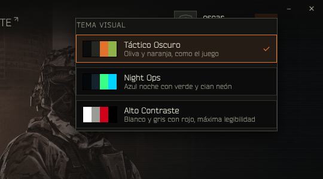
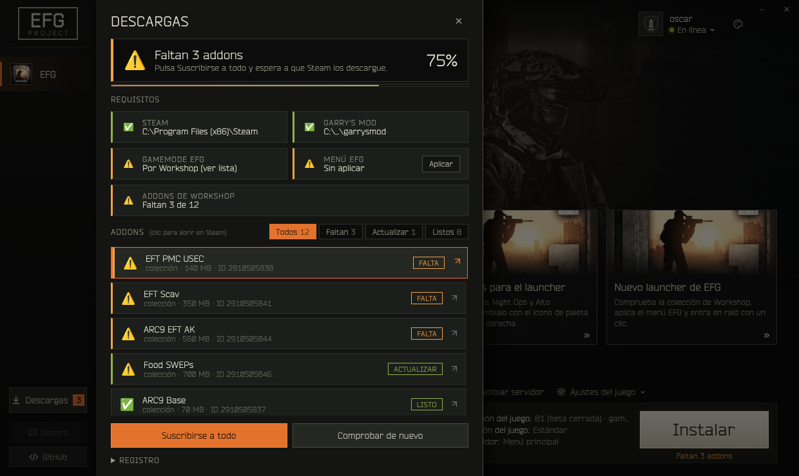

# Launcher de EFG: plan de desarrollo

Tecnología: **Python 3 + pywebview (WebView2) con interfaz HTML/CSS/JS**, y Tkinter como respaldo si no hay WebView2. Es la que ya usa `tools/launcher/`; este plan la amplía sin cambiar de pila.

## Arquitectura

```
tools/launcher/
├── efg_core.py          lógica sin interfaz: Steam, Workshop, noticias, lanzamiento (usable desde consola)
├── efg_launcher.py      ventana pywebview + clase Api (puente JS -> Python)
├── efg_launcher_tk.py   interfaz de respaldo (mismos temas, menos funciones)
├── launcher.json        configuración que se empaqueta (colección, addons, enlaces, tema por defecto)
├── noticias.json        noticias de respaldo (la copia remota manda)
└── web/
    ├── index.html       estructura
    ├── temas.css        los 3 temas: solo tokens de color
    ├── launcher.css     diseño: usa solo var(--efg-*), nunca colores fijos
    ├── temas.js         EFGTemas: aplicar, recordar y pintar el selector
    ├── descargas.js     EFGDescargas: panel de descargas en tarjetas
    └── launcher.js      arranque, JUGAR, noticias, servidores y órdenes
```

Reglas:
- La lógica vive en `efg_core.py` y no sabe nada de la interfaz. `Api` solo traduce a diccionarios para JS.
- Ninguna función de `Api` lanza excepciones hacia JS: devuelven `{ok, mensaje}` o listas de líneas para el registro.
- Lo que el jugador cambia (servidor, carpeta de GMod, tema) se guarda en `launcher.local.json` (o en `launcher.json` junto al .exe), nunca en el empaquetado.

---

## 1. Temas

**Solo tres temas, sin colores libres.** `temas.css` define los mismos tokens para cada tema bajo `:root[data-tema="..."]`; `launcher.css` solo consume `var(--efg-*)`. Añadir un cuarto tema sería añadir un bloque y una entrada en `EFGTemas.lista`, pero la interfaz no deja crearlos.

| Token | Táctico Oscuro | Night Ops | Alto Contraste |
|---|---|---|---|
| `--efg-bg0` (fondo) | `#0b0c0b` | `#05080b` | `#f4f4f2` |
| `--efg-bg1` (paneles) | `#141513` | `#0a1016` | `#ffffff` |
| `--efg-bg2` (tarjetas) | `#1c1e1b` | `#0f1820` | `#e6e6e3` |
| `--efg-bg3` | `#252723` | `#15212b` | `#d9d9d5` |
| `--efg-line` / `line2` | `#2e302c` / `#45483f` | `#16303a` / `#1f4a55` | `#9a9a96` / `#4a4a48` |
| `--efg-text` / `text-hi` | `#c8c6b4` / `#e8e6d6` | `#b8d6cf` / `#e4fff6` | `#1a1a1a` / `#000000` |
| `--efg-acento` | `#e3722d` naranja | `#39ff88` verde neón | `#d0021b` rojo |
| `--efg-acento2` | `#8fb34a` | `#00d4ff` cian neón | `#1a1a1a` |
| `--efg-ok` / `aviso` / `mal` | `#8fb34a` / `#f0a245` / `#c0392b` | `#39ff88` / `#ffd23f` / `#ff4d6d` | `#1e7b34` / `#a35a00` / `#d0021b` |
| `--efg-brillo` (halo hover) | `.45` | `.7` | `.25` |

Flujo del tema:
1. `index.html` lee `localStorage["efg-tema"]` en el `<head>` y pone `data-tema` antes de pintar (sin parpadeo).
2. `Api.Inicio()` devuelve `config.tema` (validado con `efg_core.TemaValido`) y `EFGTemas.Inicia` lo aplica.
3. Al elegir otro en el selector (icono de paleta, arriba a la derecha) se añade `html.cambiando-tema` 350 ms para fundir los colores y se guarda con `Api.GuardaTema`.
4. La interfaz Tk lee el mismo `tema` y usa `PALETAS` con los mismos colores.



### Descargas en tarjetas

Antes era una lista de texto. Ahora tiene tres niveles de lectura:
1. **Resumen**: icono grande (✅ listo, ⚠️ faltan, ❌ bloqueado), una frase con qué hacer y el porcentaje con barra.
2. **Requisitos**: rejilla de tarjetas (Steam, Garry's Mod, Gamemode, Menú EFG, Addons) con borde de color por estado y botón de acción cuando hay arreglo (Instalar, Elegir carpeta, Aplicar).
3. **Addons**: filtros Todos / Faltan / Actualizar / Listos con contador; cada addon es una tarjeta con icono, título, origen, tamaño, ID y chip de estado. Se ordenan por lo que pide acción. Clic abre su página en Steam.

El registro técnico queda plegado al final.



### Micro-interacciones

- **JUGAR**: sube 2 px, aumenta el halo del acento y el espaciado de letras, un reflejo cruza el botón (`background-position` de una capa de degradado), se hunde al pulsar (`scale(.98)`) y late mientras arranca GMod (`.lanzando`).
- **Tarjetas de noticias**: suben 4 px, borde con el acento, barra superior que se dibuja de izquierda a derecha, zoom suave de la imagen y la flecha avanza.
- **Tarjetas de Descargas**: entran en cascada (retraso escalonado hasta 0,3 s), se desplazan 3 px con barra lateral del acento al pasar el ratón.
- Curva común `--suave: cubic-bezier(.2,.8,.2,1)`. Con "reducir movimiento" de Windows se desactivan.

---

## 2. Lógica

### Detectar Steam (`efg_core.DetectaSteam`)
Devuelve `(ruta, origen)` y no da nada por supuesto:
1. Registro de Windows: `HKCU\Software\Valve\Steam\SteamPath`, `HKLM\SOFTWARE\WOW6432Node\Valve\Steam\InstallPath`, `HKLM\SOFTWARE\Valve\Steam\InstallPath`.
2. Protocolo `HKCR\steam\Shell\Open\Command` (sobrevive a reinstalaciones raras).
3. Proceso `steam.exe` en marcha (PowerShell `Get-Process steam`).
4. Rutas habituales en todas las unidades (`X:\Program Files (x86)\Steam`, `X:\Steam`...).

Una ruta solo vale si tiene `steam.exe` o `steamapps/`. Las bibliotecas extra salen de `libraryfolders.vdf`.

### JUGAR (`efg_core.Lanza`)
```python
r = core.Lanza(steam, config)   # {"ok": bool, "mensaje": str, "comando": str}
```
- Sin Steam -> error claro. Sin GMod (`appmanifest_4000.acf`) -> abre `steam://install/4000` y lo explica.
- IP validada (`host[:puerto]`) antes de pasarla a Steam.
- `"lanzamiento": "argumentos"` (por defecto): `steam.exe -applaunch 4000 +gamemode escapefromgmod +connect IP`.
- `"lanzamiento": "protocolo"`: `steam://connect/IP` (sin gamemode ni argumentos extra).
- `OSError` al ejecutar `steam.exe` -> último recurso `steam://rungameid/4000`.
- En la interfaz, un fallo deja la nota bajo JUGAR y abre Descargas con el registro.

---

## 3. Addons

`launcher.json`:
```json
"coleccion": "3224545557",
"addons": ["131759821", {"id": "3744199003", "motivo": "mochilas y comida"}],
"extra": [...]
```
- `Instalados(gmod)` lee `steamapps/workshop/content/4000/<id>` (carpeta con archivos) y `appworkshop_4000.acf`.
- `Requeridos(config)` expande la colección con la API pública de Steam y añade `addons` y `extra`. Si no hay red, `RequeridosSinRed` comprueba al menos los IDs escritos en `launcher.json`.
- `EstadoAddons` marca cada uno como `ok`, `falta` o `viejo` (versión de la Workshop más nueva que la local).
- **Suscribirse a todo** (`SuscribeTodo`): Steam no permite suscribirse sin que el jugador pulse el botón, así que abre la colección (que tiene su propio "Suscribirse a todo") y, para los addons sueltos que falten, abre sus páginas una a una con 1,5 s de pausa (máximo 15).

---

## 4. Noticias y comunidad

- `noticias_url` apunta al `noticias.json` de `main` en GitHub (raw). Publicar una noticia = editar ese archivo y hacer push; no hay que recompilar.
- Formato: lista (o `{"noticias": [...]}`) de `{titulo, texto, fecha, etiqueta, tipo: "destacada", imagen, url}`. `LimpiaNoticias` descarta lo inválido y las URL que no sean http, https o steam.
- Orden de carga: remoto -> `noticias.cache.json` (última copia buena) -> `noticias.json` empaquetado. La pestaña dice de dónde salen.
- Se refrescan solas cada 10 minutos y con el botón **Actualizar**.
- Botones **Discord** y **GitHub** en la barra lateral, desde `enlaces.discord` y `enlaces.github`. Si falta la URL, el botón sale apagado con un aviso.

---

## Pendiente

1. Poner la invitación de Discord en `launcher.json` -> `enlaces.discord`.
2. Recompilar el .exe en el PC con `build_launcher.bat` y probar en WebView2 real (aquí solo se probó en Chromium con Steam simulado).
3. Rellenar el ID del gamemode en `extra` cuando se publique.
4. Opcional: alojar `noticias.json` fuera de GitHub si se quieren imágenes remotas pesadas.
