# Novedades de EFG

Una imagen por commit, la más reciente arriba. Se generan con `python tools/novedades.py cambios.json`.

## 2026-10-31 · Iconos de USEC y BEAR según su historia

facciones (USEC, BEAR) (baja)

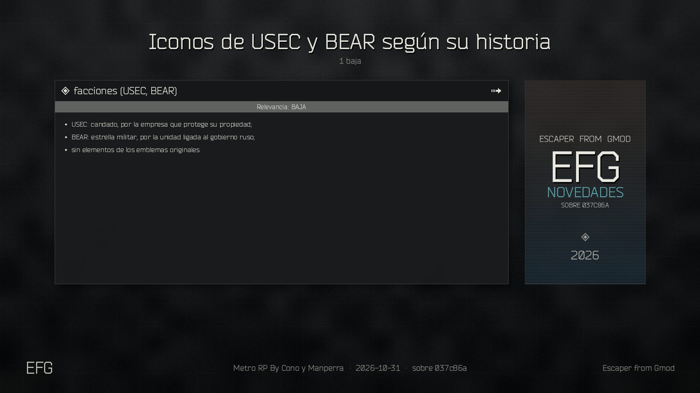

## 2026-10-31 · Iconos nuevos para las facciones

facciones (PMC, Scav, Staff) (baja)

## 2026-10-31 · Logo e icono de EFG en todos los menús

menús y pantalla principal (media)

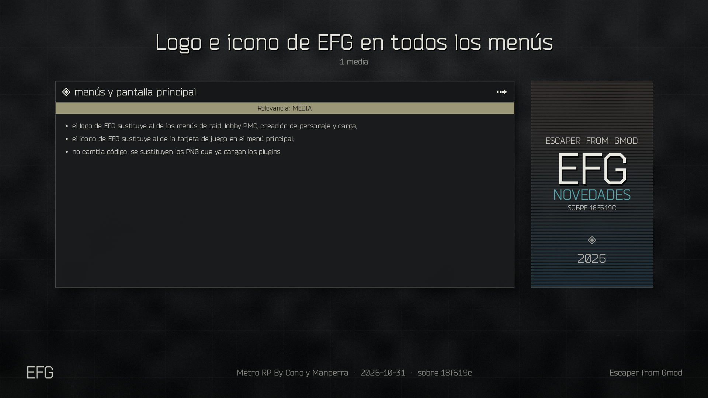

## 2026-10-31 · Rebranding de logo e icono de EFG

menú principal de GMod (baja)

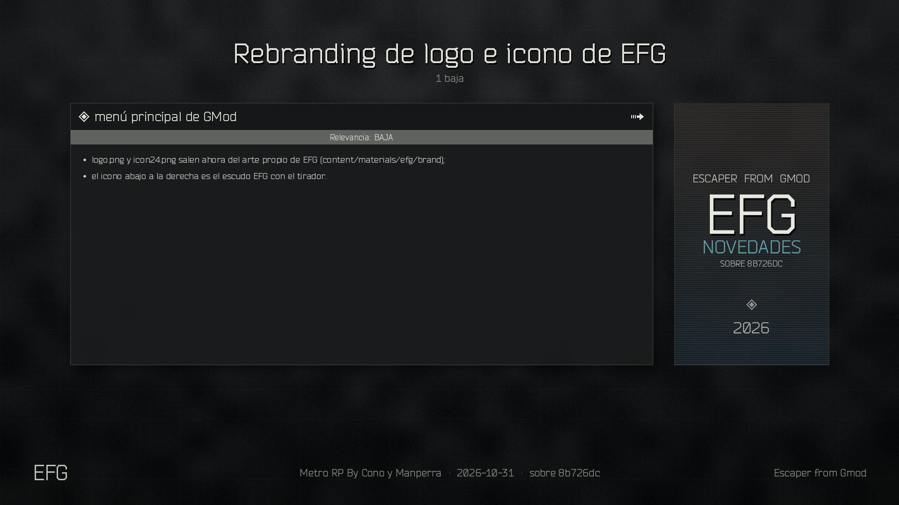

## 2026-10-31 · Logo propio de EFG en el menú de GMod

menú principal de GMod (baja)

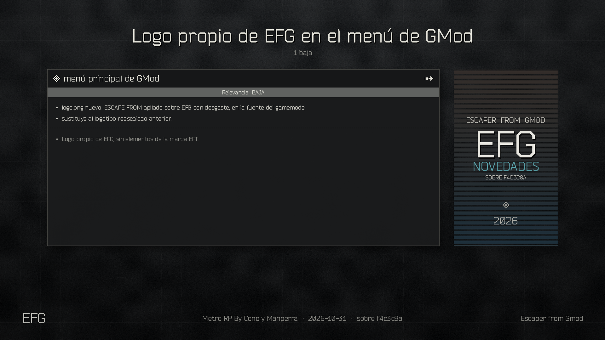

## 2026-10-31 · Portada y logo de EFG en el menú principal

menú principal de GMod (media), herramientas (baja)

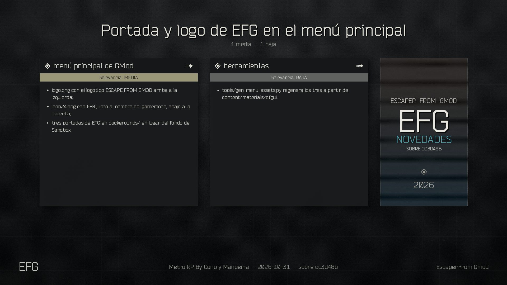

## 2026-10-31 · Arreglo de la pestaña de objetos del menú Q

spawnmenu_itemtab (crítica)

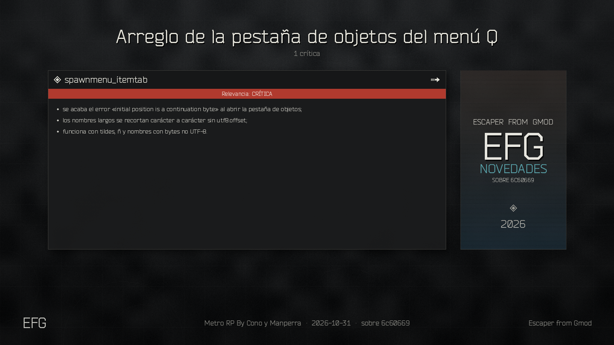

## 2026-10-31 · Medicinas en primera persona

Animaciones médicas (crítica)

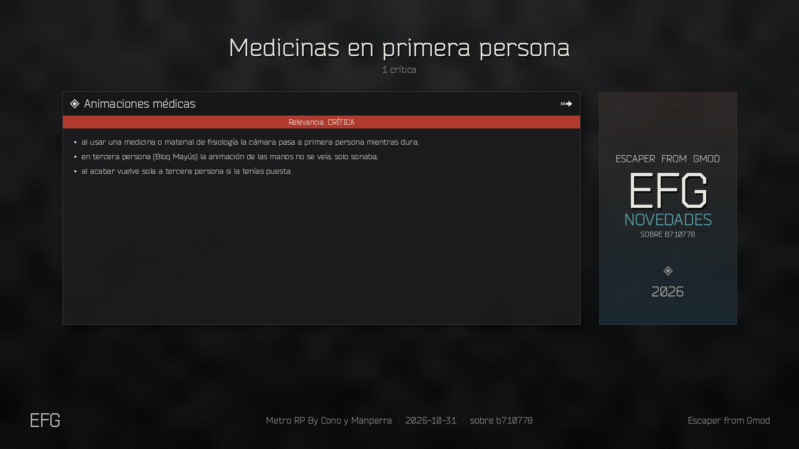

## 2026-10-31 · Animación de medicinas con un arma ARC9 en la mano

Animaciones médicas (crítica)

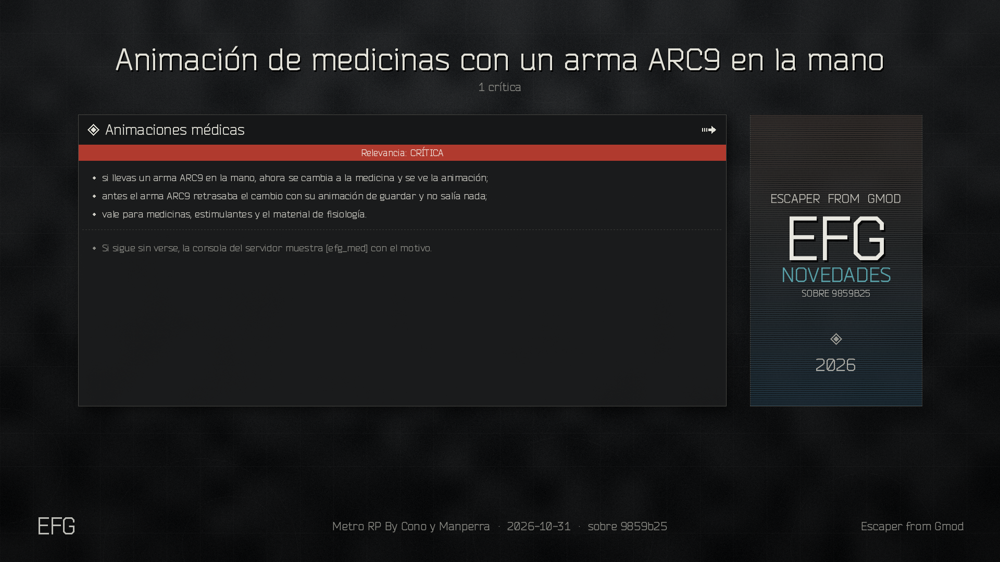

## 2026-10-31 · Puertas interactivas

efg_doors (nuevo) (alta), efg_hud (media), Documentación (baja)

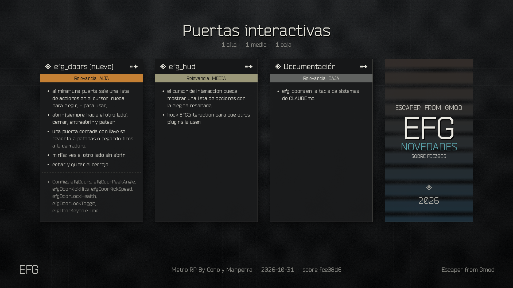

## 2026-10-31 · Animaciones del material de fisiología

Material de fisiología (alta), Usar y aplicar al compañero (media), Contenido (baja)

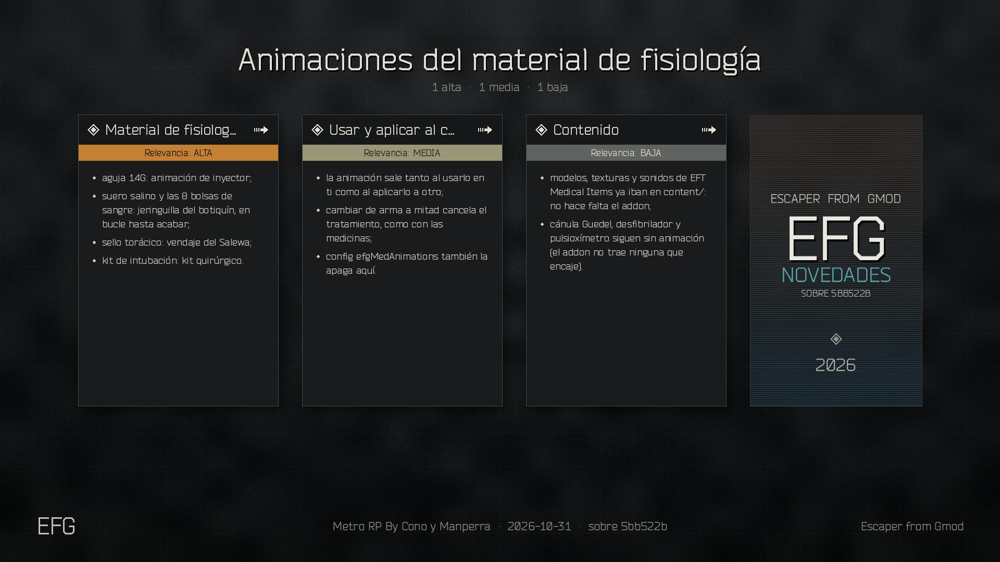

## 2026-10-31 · Arreglos del sistema médico

Muertes y Scav run (crítica), Sangrado y regeneración (crítica), Objetos médicos (alta), Avisos y otros (media)

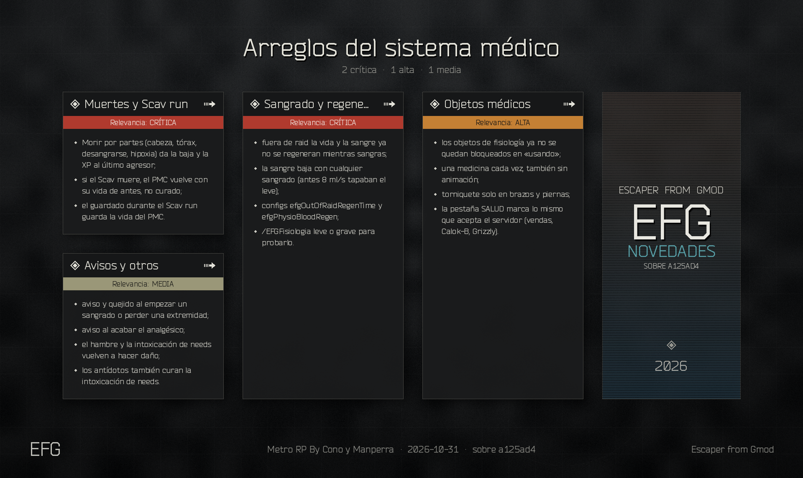

## 2026-10-30 · Se trabaja solo en gamemodes

Instalación (media), Herramientas y README (baja)

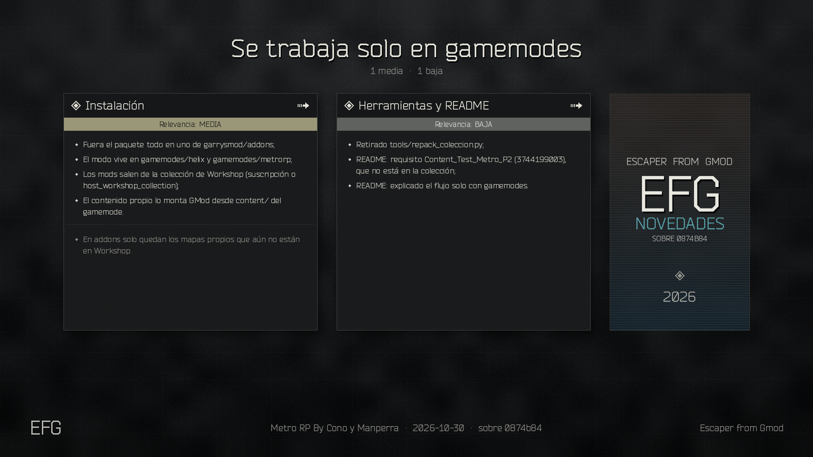

## 2026-10-30 · Imagen resumen del README

docs/readme (baja)

## 2026-10-30 · Roadmap en el README

README (baja)

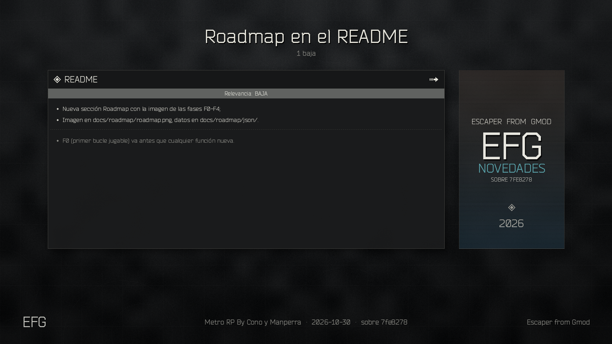

## 2026-10-30 · Auditoría de inconsistencias del gamemode

metrocrafting (crítica), habilidades, missions (alta), efg_tasks (media), efg_inspect (media), vigilancia (baja)

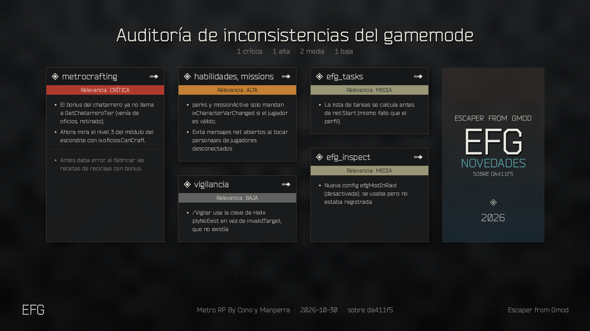

## 2026-10-30 · Arreglo de errores del perfil

efg_profile (crítica)

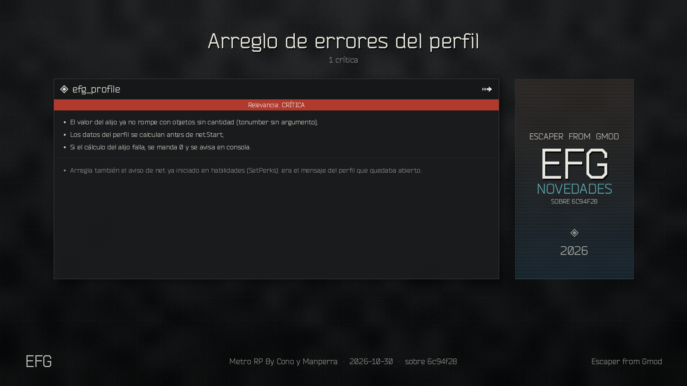

## 2026-10-30 · Imagen de novedades en cada commit

tools/novedades.py (baja)

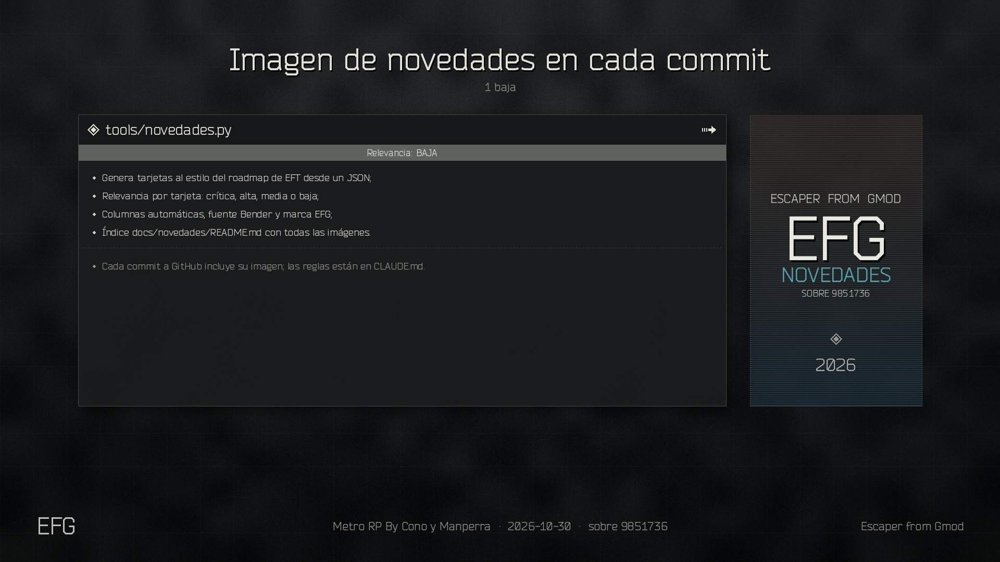

## 2026-10-30 · Registro y test del ciclo de raid

efg_testcycle (alta), Comandos (media), Documentación (baja)

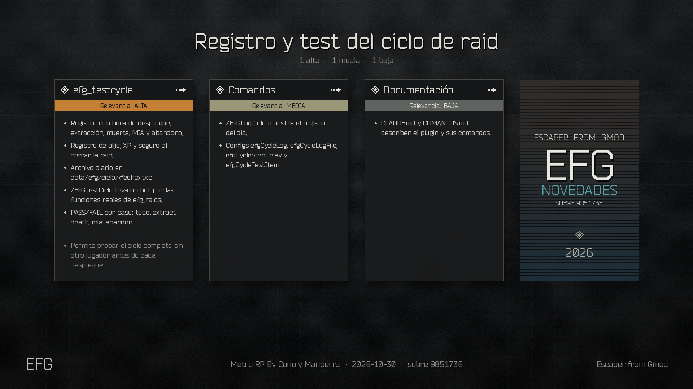

